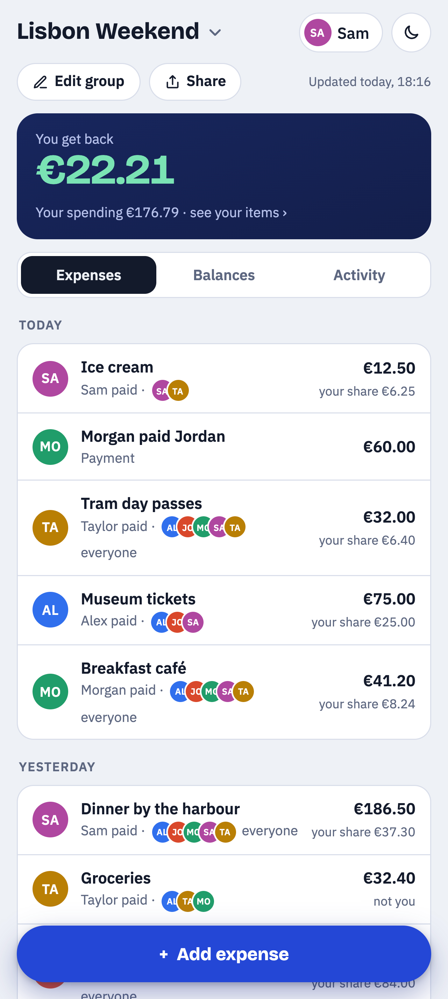
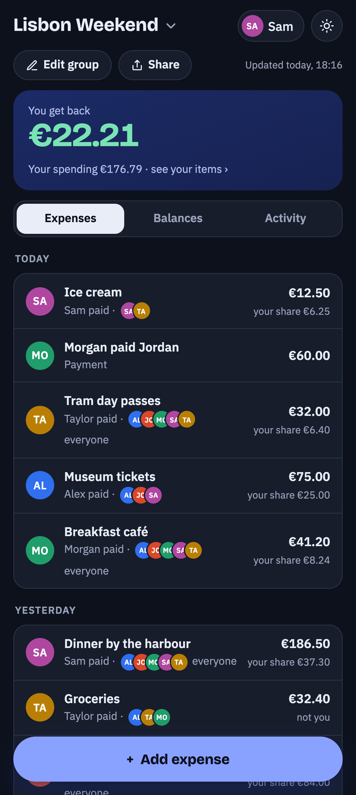
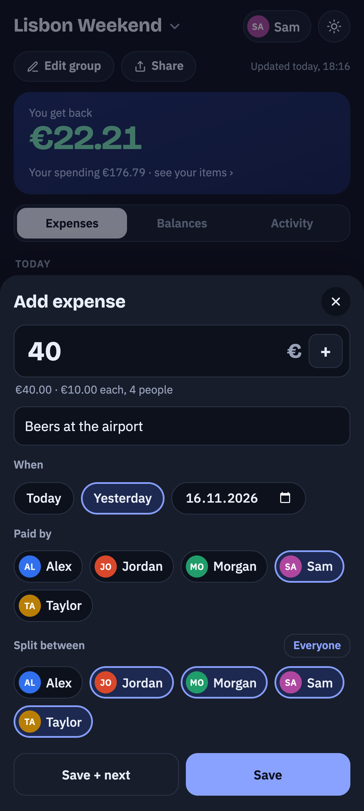
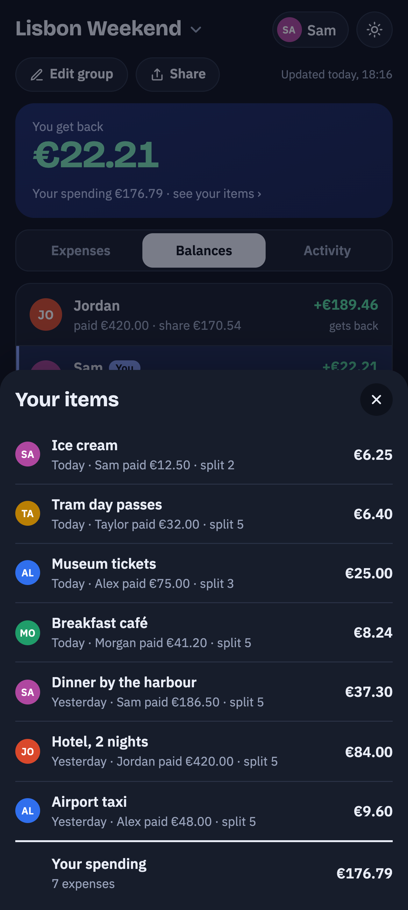
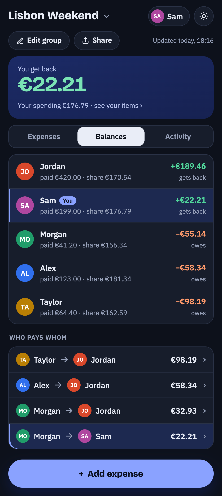
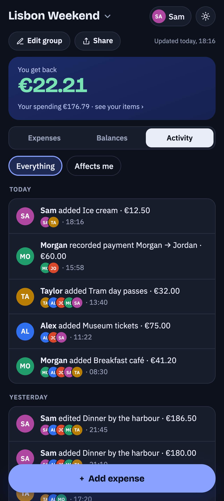

# Group expenses

Expense splitting without sign-up. Everyone with the link sees changes live, and groups opened before
work offline, syncing when the connection returns. Svelte 5 + Vite, Firestore for data, Cloudflare Workers
for hosting. No backend.

<table>
  <tr>
    <td></td>
    <td></td>
    <td></td>
  </tr>
  <tr>
    <td align="center">Expenses (light theme)</td>
    <td align="center">Expenses (dark theme)</td>
    <td align="center">Add expense</td>
  </tr>
  <tr>
    <td></td>
    <td></td>
    <td></td>
  </tr>
  <tr>
    <td align="center">Your items</td>
    <td align="center">Balances</td>
    <td align="center">Activity</td>
  </tr>
</table>

## Setup

Two Firebase projects: one for local development, one for the deployed site.

1. For each, create a Firebase project with a Firestore database and a Web app.
2. Copy `.env.example` to `.env.development` and `.env.production` and fill in each web app config.
   `npm run dev` uses the first; `npm run build` and the deploys use the second.
3. `npx firebase-tools login`, then `npm run deploy:rules:dev` and `npm run deploy:rules`.
4. `npm run dev`

The API key in the env files is not a secret (it ships in the bundle). Restrict it to your domains under
Google Cloud console → Credentials → HTTP referrers.

## Commands

| | |
|---|---|
| `npm run dev` | dev server |
| `npm run check` | type check |
| `npm test` | unit tests |
| `npm run deploy:rules` | deploy `firestore.rules` to the production project |
| `npm run deploy:rules:dev` | deploy `firestore.rules` to the development project |
| `npm run deploy:site` | build and deploy to Cloudflare Workers (`wrangler login` first) |

For Git-based deploys (Workers Builds): build command `npm run build`, deploy command
`npx wrangler deploy`, preview command `npx wrangler versions upload`, and the three
`VITE_FIREBASE_*` variables of the production project set as build variables.

## Data model

```
groups/{groupId}                 name, members{memberId: {name, colorIndex}}, createdAt, updatedAt
groups/{groupId}/ledger/{id}     expenses and settle-up payments
groups/{groupId}/activity/{id}   change log: actor and a structured change, ordered by server time
```

- The group ID is the only access control: `get` is public, `list` is denied.
- Every write inside a group must bump the group's `updatedAt` in the same batch (enforced by the
  rules, done by `src/data/groupBatch.ts`). `createdAt` and `updatedAt` are server timestamps, so
  per-group stats can be read from the Firebase console.
- The group switcher lists groups remembered in the browser's localStorage.

## Offline

- A service worker (production builds only, needs HTTPS or localhost) caches the app so it opens offline.
- Firestore's persistent cache serves groups opened before and queues writes until the connection returns.
  Saves therefore never wait for the server; a write the server rejects is rolled back and reported by a toast.
- Conflicts are last-write-wins per document. Deleting a group requires a connection.

## Layout

```
src/shared     types and pure logic (money, dates, members)
src/data       Firestore access and document mapping
src/local      per-device storage (remembered groups, chosen member)
src/routing    / and /g/{groupId}/{slug} (slug is cosmetic)
src/ui         shared components
src/features   screens and sheets, by feature
```
